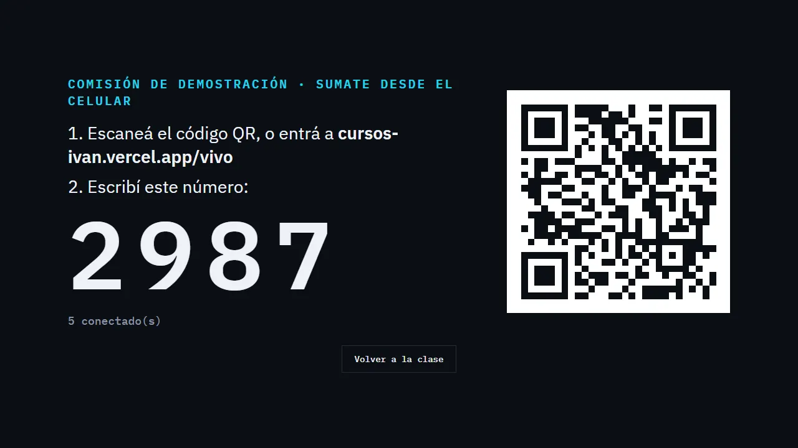
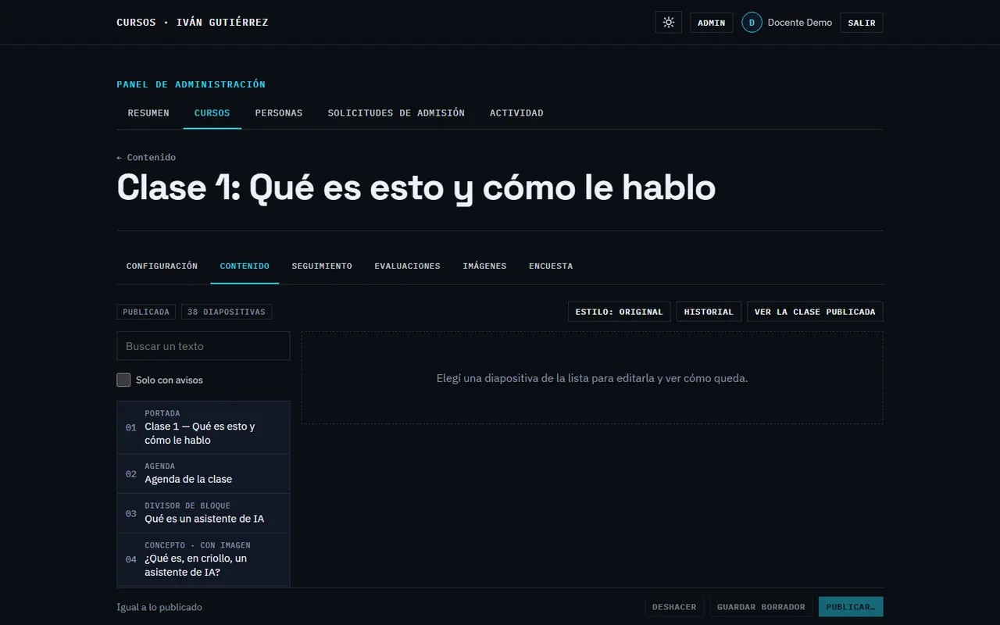
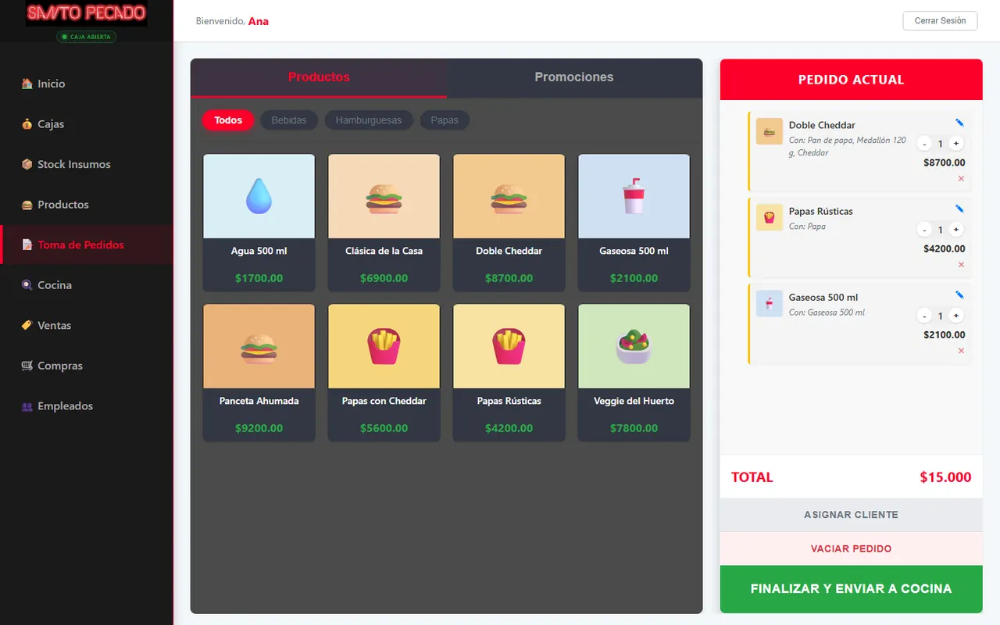
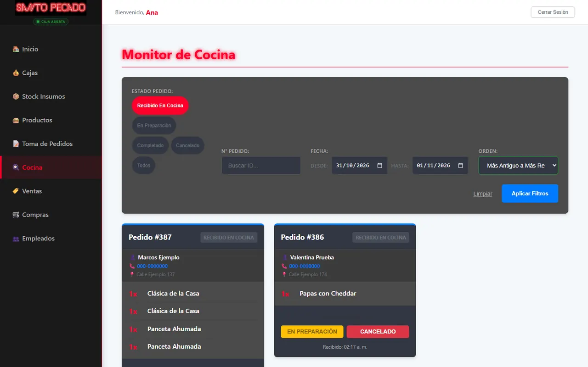
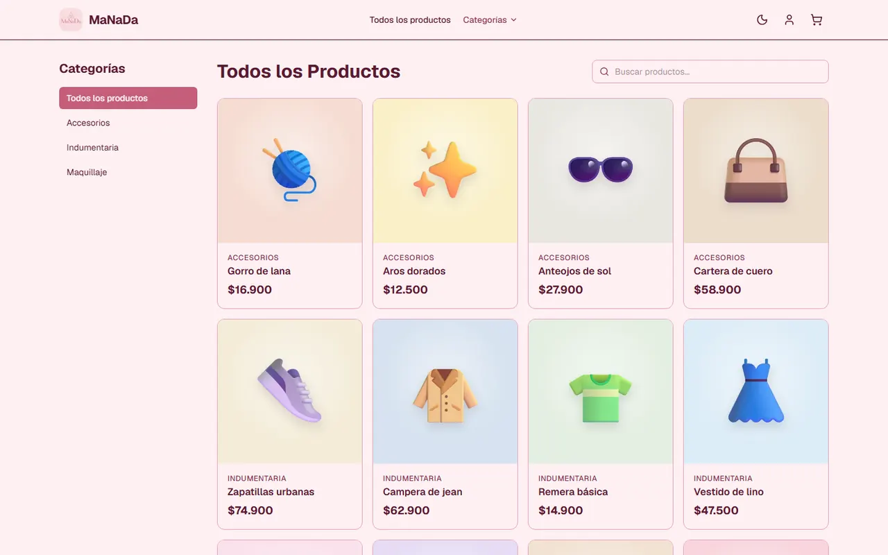
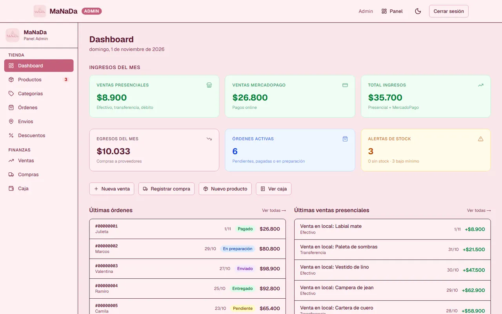
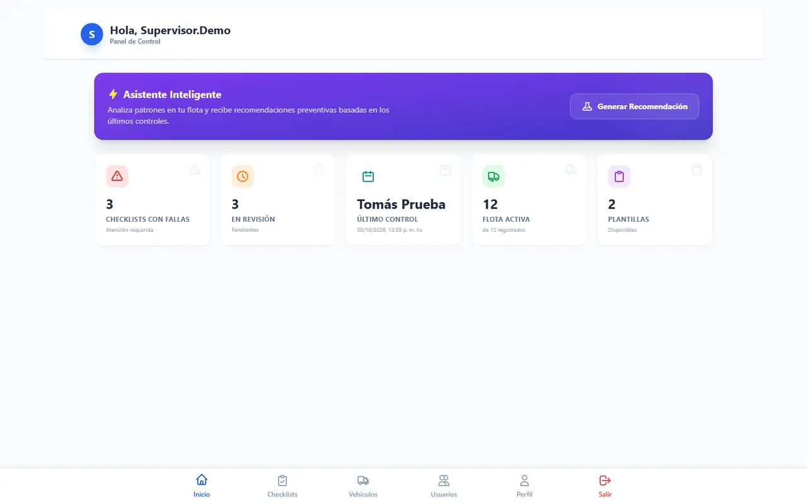
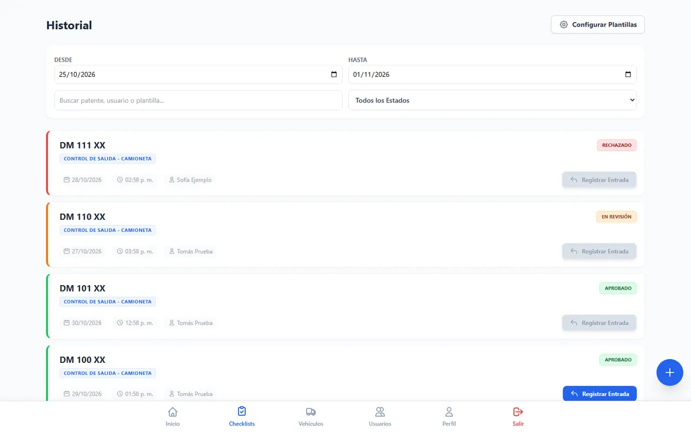
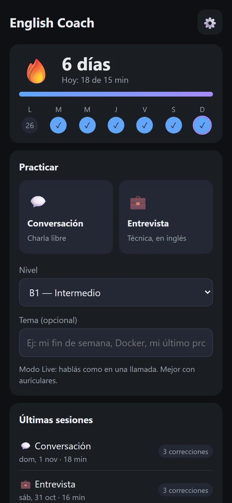
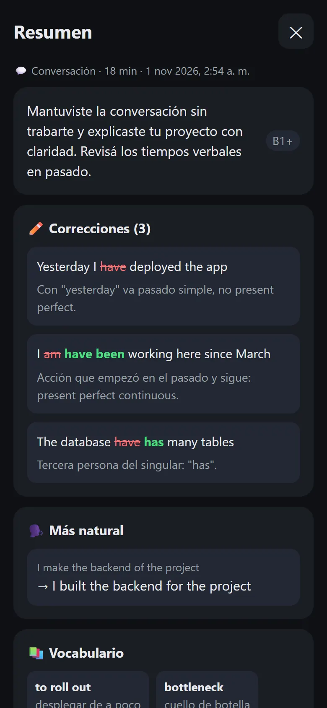

<h1 align="center">Iván Gutiérrez</h1>

  <b>Analista de Sistemas · Desarrollador backend / full stack</b> 
  Salta, Argentina · Presencial o remoto, incluido el exterior · Español nativo, inglés B2

  
  
  
  
  

---

Desarrollo de punta a punta, pero lo que más disfruto es **lo que está debajo de la interfaz**: el modelo de datos, la lógica de negocio y la arquitectura. Tengo sistemas propios y para clientes **en producción**, y hoy sigo formándome en **Cloud y DevOps**.

- 🔍 **Busco trabajo** como desarrollador backend / full stack o analista de sistemas.
- 🧱 Me importa que el sistema sea **correcto bajo carga real**: transacciones, idempotencia, permisos en la base y tests de los flujos críticos.
- ☁️ Cursando la **Tecnicatura en Cloud y DevOps** (UPATECO): AWS, Docker, mensajería con SQS, observabilidad.

## 🛠️ Stack

  

| | |
|---|---|
| **Lenguajes** | Python · TypeScript · JavaScript · SQL · ABAP · Java (básico) |
| **Backend** | Django · Django REST Framework · Next.js (App Router, Server Actions) · FastAPI |
| **Datos** | PostgreSQL · MySQL · Supabase (RLS, funciones SQL) · Drizzle ORM |
| **Infra / DevOps** | Docker · AWS (SQS, EC2, S3 vía LocalStack) · Vercel · Netlify · Linux |
| **Calidad** | Playwright (E2E) · Vitest · Pytest · Scrum |

## 🚀 Proyectos destacados

### 🎓 Plataforma de cursos interactivos · *en producción*
Diapositivas, **clase en vivo con quiz y ranking**, evaluaciones y panel de administración. La uso para dictar cursos reales en la **Municipalidad de Salta**.

- La clase en vivo se sincroniza por **Supabase Realtime (Broadcast)** con una consulta de respaldo; la base es la fuente de verdad.
- **Permisos con Row Level Security**: las reglas de acceso viven en la base, no solo en la interfaz.
- El puntaje del quiz se mide con la **hora de PostgreSQL**, no la del navegador, para que el reloj de un celular no altere el ranking.
- Login sin contraseña (magic link) y resumen de cada clase en **PDF**.

    

🔗 [**Demo**](https://cursos-ivan.vercel.app) · [Código](https://github.com/IvanGG97/Cursos) · [Caso de estudio](https://ivan-gutierrez.netlify.app/es/projects/plataforma-cursos/)

  
  

---

### 🍔 Santo Pecado · ERP con punto de venta · *en producción*
Sistema a medida para una hamburguesería artesanal: toma de pedidos, **monitor de cocina**, stock por receta, caja, compras y personal.

- **Stock calculado por receta**: cada producto descuenta sus insumos.
- El descuento ocurre cuando el pedido **empieza a cocinarse**, dentro de una **transacción con bloqueo de fila** (`select_for_update`) para evitar ventas de stock que no existe.
- **Roles por área de trabajo** (caja, cocina, administración) con autenticación JWT.
- Dashboard con métricas de ventas, medios de pago y alertas de stock.

    

🔗 [Backend](https://github.com/IvanGG97/santo-pecado-backend) · [Frontend](https://github.com/IvanGG97/santo-pecado-frontend) · [Caso de estudio](https://ivan-gutierrez.netlify.app/es/projects/santo-pecado/)

  
  

---

### 🛍️ MaNaDa · Ecommerce · *freelance*
Tienda de indumentaria, maquillaje y accesorios con **pagos por Mercado Pago** y un panel que junta ventas web, ventas en el local, compras y caja.

- El **webhook de Mercado Pago confirma el pago y es idempotente**: un aviso repetido no duplica la orden.
- **Stock atómico en una función SQL** para que dos compras simultáneas no vendan la misma unidad.
- Reintentos de pago sin órdenes acumuladas y **una sola caja** para ventas online y presenciales.
- **Tests E2E con Playwright** sobre los flujos críticos (carrito, checkout, pago).

     

🔗 [Código](https://github.com/IvanGG97/manada.-project) · [Caso de estudio](https://ivan-gutierrez.netlify.app/es/projects/manada/)

  
  

---

### 🚛 CyS Group · Checklist digital de flota · *freelance, equipo de 2*
Control digital de una **flota minera de 150 vehículos**: inspecciones de salida y entrada con fotos, aceptación de choferes, roles y PDF con firmas. Hice el backend de checklists y movimientos, y el frontend.

- **Plantillas reutilizables** en lugar de formularios fijos: un control nuevo no requiere tocar código.
- **Historial auditable** y estado de la unidad según ítems críticos.
- Optimizado para inspecciones de **más de 100 ítems** desde el celular.

    

🔗 [Caso de estudio](https://ivan-gutierrez.netlify.app/es/projects/cys-checklist/) *(código privado del cliente)*

  
  

---

### 🗣️ English Coach · PWA de voz con IA
App para practicar inglés todos los días: **conversación por voz en tiempo real** con Gemini Live, modo por turnos de respaldo y un resumen con correcciones al terminar.

- Audio capturado con **AudioWorklet** (PCM 16 kHz) y respaldo automático si el modo en vivo falla.
- **Sin backend ni clave compartida**: cada usuario usa su propia API key, guardada solo en su dispositivo.

  

🔗 [**Probar la app**](https://ivangg97.github.io/english-coach/) · [Código](https://github.com/IvanGG97/english-coach)

  
  &nbsp;
  

## ☁️ Proyectos de Cloud y DevOps (en equipo)

| Proyecto | Qué hice |
|---|---|
| [**Vulcano Pay**](https://github.com/crescendollow/vulcano-pay) · notificaciones financieras con arquitectura orientada a eventos (FastAPI + AWS SQS en LocalStack + DLQ) | Receptor de webhooks con **firma HMAC-SHA256** en tiempo constante y protección contra replay; **logging JSON asíncrono** con rotación gzip. |
| [**Proyecto Fénix**](https://github.com/FernandaPuca1811/Proyecto_fenix) · remediación automática de recursos AWS (EC2/S3) a partir de eventos | Verificación de firma del webhook, **worker** y servicio de **remediación** idempotente (ledger por `event_id`, errores transitorios vs. permanentes). |

## 🧩 Otros trabajos

- **Pipeline OCR de CVs** · pasantía en Gestión de Talentos SA: lectura automática con Tesseract y una API de IA como alternativa para formatos no estándar.

## 🎓 Formación

- **Técnico Superior en Análisis de Sistemas** · Instituto Superior del Milagro (2024 – 2025) · *orador en la colación*
- **Tecnicatura en Cloud y DevOps** · UPATECO (2026 – actualidad)
- **SAP ABAP + Inglés para IT** · Impulso Digital (2026, 350 h)

---

  📫 ¿Tenés una búsqueda abierta? Escribime a <a href="mailto:ivangonzalogutierrezgg@gmail.com">ivangonzalogutierrezgg@gmail.com</a>

